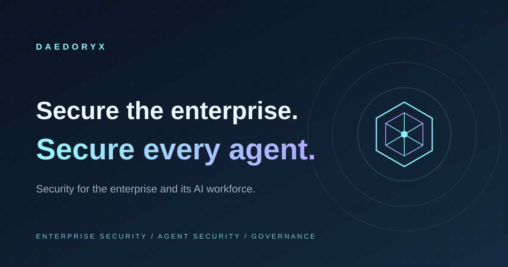

# DAEDORYX — Enterprise AI Operating Layer



A static, animated marketing website and an interactive, eight-slide executive event presentation for DAEDORYX.

**Status: pre-publication preview.** Product architecture is conceptual and commercial availability is not confirmed. Business-impact statistics are **scenario calculations**, not outcomes measured at DAEDORYX or its customers.

## What is included

- Premium responsive dark-first landing with interactive agentic architecture map.
- Executive Impact Studio with five C-suite perspectives: CEO, CFO, CIO, CTO, and CISO.
- Six adjustable model assumptions and dynamically updated charts / metrics.
- Dedicated event presentation with eight slides, fullscreen, keyboard navigation, browser print/PDF, and shared scenario assumptions.
- Two-language headline/section switching (English default, Spanish option). Deep technical copy is currently English.
- Policy-first architectural narrative, realistic deployment positioning, accessible motion reduction, and visible pre-launch restrictions.
- Contact enquiry generator: **local clipboard only**, no backend API, no claim of lead capture.
- No production UI, no backend, no JavaScript dependencies.

## Local run

Serve the root directory using any static HTTP server, for example:

```bash
python3 -m http.server 8080
```

Open:

- Landing: http://localhost:8080/
- Presentation: http://localhost:8080/present.html
- Scenario presentation directly: http://localhost:8080/present.html#slide-4

**Note:** ES modules need an HTTP server; direct `file://` loading may not work in all browsers.

## Zero-server offline event package

Run `npm run offline` to generate two standalone HTML files in `offline/`, plus supporting local assets. Double-click `daedoryx-landing-offline.html` or `daedoryx-presentation-offline.html`; unlike the source files they run directly from `file://` without hosting or internet. GitHub Actions builds and uploads the same offline event package as a downloadable workflow artifact, valid for 30 days.

## Verification

Requires Node.js 22+; zero `npm install` dependencies.

```bash
npm run check
```

This runs syntax validation, scenario arithmetic tests and structural website validation.

## Presenting at an event

Visit the Executive Impact Studio, adjust operational assumptions, and use **Present this scenario live** to carry all six values to the presentation.

On the deck use arrow keys, Page Up/Page Down, Home/End, Space for next, **F** for fullscreen and **P** for print / save as PDF. Sliders on slide 4 continue to update CEO/CFO/CIO/CTO scenario outputs on slide 5.

Print the presentation using browser landscape mode, or prepare a local HTTP-server fallback if the venue has unreliable internet. See [Presenter Guide](docs/event-presenter-guide.md).

## Economic model

The default example uses 15,000 work items/month, 18 minutes each, 45% coverage, 35% time reduction, $55/hour, and $150,000/year assumed cost. It illustrates 8,505 annual hours potentially released and $467,775 capacity value. This is **not** DAEDORYX financial performance, a product benchmark, or automatically cashable savings.

See [scenario methodology](docs/scenario-methodology.md) for reproducible formulas and limitations.

## File map

| Path | Purpose |
| --- | --- |
| `index.html` | Main B2B landing and impact studio |
| `styles.css` | Design system, layout and responsive behavior |
| `app.mjs` | Landing interactions, language toggle, clipboard-only enquiry |
| `model.mjs` | Pure financial scenario computation |
| `present.html` | Event deck |
| `presentation.css` | Fullscreen/print deck styling |
| `present.mjs` | Slide navigation, keyboard controls and synced model |
| `tests/` | Calculation tests |
| `scripts/validate-site.mjs` | Local asset, anchor, and metadata checks |
| `docs/` | Event, scenario, and publication instructions |
| `AGENTS.md`, `CLAUDE.md` | Agent-first engineering standards |

## Hosting

Any static hosting service can serve these files from its public root. Configure HTTPS, correct content types and equivalent response headers to `_headers` at the hosting edge; not all providers (notably GitHub Pages) interpret that file. This preview deliberately declares `noindex` and `robots.txt` disallows search engines.

There is **no configured public production deployment**, and no server-side lead intake. Before commercial publication complete the [publication checklist](docs/publication-gates.md), including legal operator, privacy, product evidence, independent QA, and contact integration.

## Contribution standards

Read [AGENTS.md](AGENTS.md) and [CLAUDE.md](CLAUDE.md). Submit reviewed PRs; no fabricated customer data or unverified product claims.
